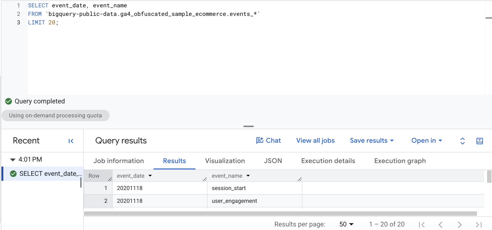
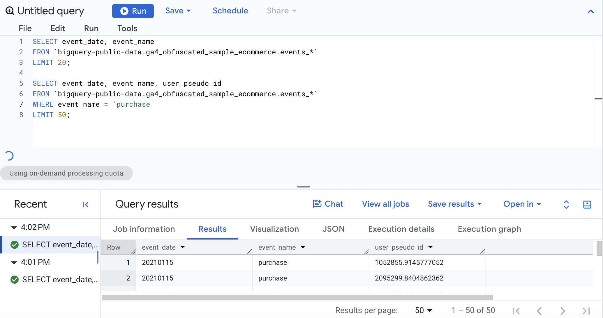
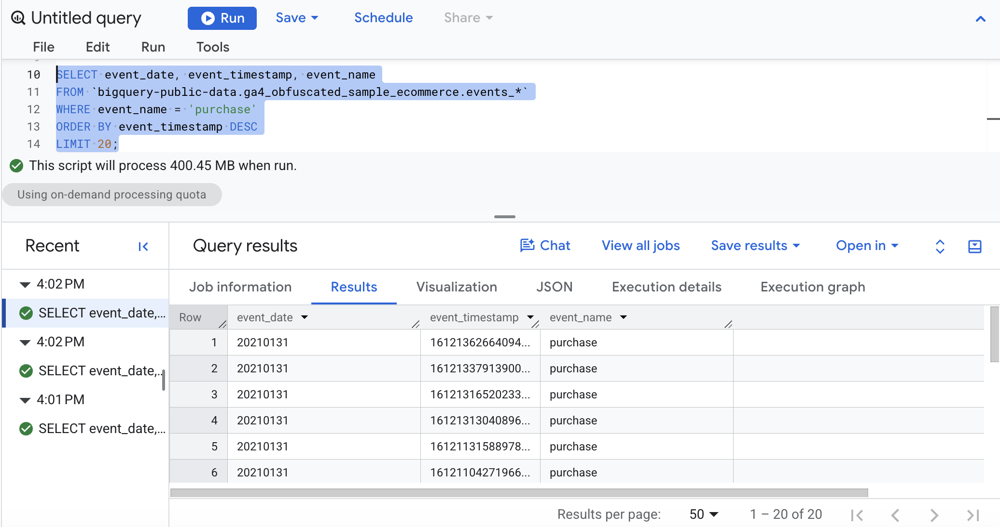
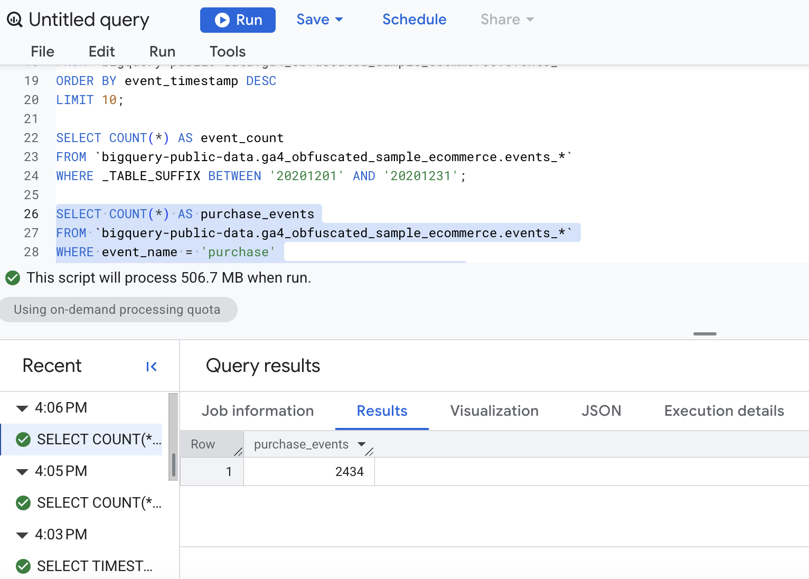
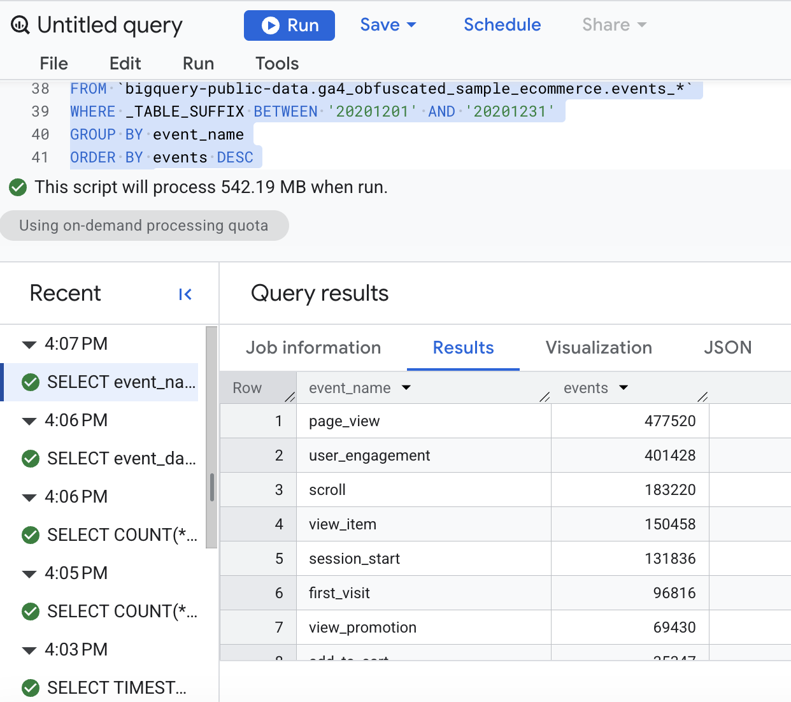

# Overview

This notebook walks through the queries from Lecture 1 using the public GA4 sample dataset in BigQuery: `bigquery-public-data.ga4_obfuscated_sample_ecommerce`.

Each section shows the query, explains what it does, and includes a screenshot of the output.

> **Note:** The [BigQuery Export Schema](https://support.google.com/analytics/answer/7029846#zippy=%2Cevent) contains variables and levels that are not shown in the GA4 dataset.

# Query Basics

## SELECT / FROM / LIMIT

``` sql
SELECT event_date, event_name
FROM `bigquery-public-data.ga4_obfuscated_sample_ecommerce.events_*`
LIMIT 20;
```

**What it does:** `SELECT` picks the columns (`event_date`, `event_name`), `FROM` names the table (the `events_*` wildcard covers all daily tables), and `LIMIT 20` returns only 20 rows.

**Output:**

**What I see:** The query returned 20 rows with two columns, `event_date` and `event_name`. All 20 rows have the date 20201118 (stored as YYYYMMDD), and the events are basic site activity: `session_start`, `page_view`, `user_engagement`, `scroll`, and `first_visit`. Because there is no `ORDER BY`, BigQuery returns an arbitrary 20 rows, so these may differ if the query is run again.

## WHERE filters rows

``` sql
SELECT event_date, event_name, user_pseudo_id
FROM `bigquery-public-data.ga4_obfuscated_sample_ecommerce.events_*`
WHERE event_name = 'purchase'
LIMIT 50;
```

**What it does:** `WHERE` keeps only rows that match a condition. Here, only rows where the event was a `purchase`, returning up to 50 of them along with the anonymous user ID.

**Output:**



**What I see:** The query returned 50 rows with three columns: `event_date`, `event_name`, and `user_pseudo_id`. Every row has `event_name = purchase`, so the `WHERE` filter worked. Most rows (1–47) are from 20210115, and the last three are from 20210109. Some `user_pseudo_id` values repeat, such as 2095299.8404862362, which appears seven times. That means one user can trigger several purchase events, so these rows are purchase events, not 50 unique buyers.

## ORDER BY sorts results

### Most recent purchases first

``` sql
SELECT event_date, event_timestamp, event_name
FROM `bigquery-public-data.ga4_obfuscated_sample_ecommerce.events_*`
WHERE event_name = 'purchase'
ORDER BY event_timestamp DESC
LIMIT 20;
```

**What it does:** Filters to purchases, then sorts by `event_timestamp` in descending order (`DESC`), so the newest purchases appear first. Without `DESC`, the default is ascending.

**Output:**



**What I see:** The query returned 20 purchase events sorted by `event_timestamp` from largest to smallest, so the most recent purchases come first. The first 19 rows are from 20210131, which is the last day in the dataset, and the final row is from 20210130. The timestamps are long numbers (microseconds since 1970), which are hard to read directly. That is why the next query converts them with `TIMESTAMP_MICROS()`.

### Readable timestamps

``` sql
SELECT TIMESTAMP_MICROS(event_timestamp) AS event_time,
       event_name
FROM `bigquery-public-data.ga4_obfuscated_sample_ecommerce.events_*`
ORDER BY event_timestamp DESC
LIMIT 10;
```

**What it does:** GA4 stores timestamps as microseconds since 1970, which is hard to read. `TIMESTAMP_MICROS()` converts them into a normal date and time, and `AS event_time` gives the new column a readable name.

**Output:**

**What I see:** The query returned 10 rows with two columns: `event_time` and `event_name`. The raw microsecond numbers are now readable timestamps (for example, 2021-01-31 23:59:55 UTC). The newest events are at the top, and the latest event in the dataset happened at about 11:59:55 PM UTC on January 31, 2021. Several events share the same timestamp, which means they were logged at the same moment, such as `page_view`, `user_engagement`, and `view_promotion`.

# Aggregating Data

## COUNT, SUM, AVG, MIN, MAX

### Count total events in a date range

``` sql
SELECT COUNT(*) AS event_count
FROM `bigquery-public-data.ga4_obfuscated_sample_ecommerce.events_*`
WHERE _TABLE_SUFFIX BETWEEN '20201201' AND '20201231';
```

**What it does:** `COUNT(*)` collapses all matching rows into one number: the total count of events in December 2020. `_TABLE_SUFFIX` limits which daily tables get scanned.

**Output:**

{width="2072"}

**What I see:** The query returned a single row with one value: `event_count` = 1,612,725. That is the total number of events logged in December 2020.

### Count purchases in a date range

``` sql
SELECT COUNT(*) AS purchase_events
FROM `bigquery-public-data.ga4_obfuscated_sample_ecommerce.events_*`
WHERE event_name = 'purchase'
  AND _TABLE_SUFFIX BETWEEN '20201201' AND '20201231';
```

**What it does:** Same idea as above, but combines two conditions with `AND`: the event must be a `purchase` and fall within December 2020.

**Output:**

{width="2072"}

**What I see:** The query returned a single row: `purchase_events` = 2,434. Out of the 1,612,725 events in December 2020, only 2,434 were purchases, which is about 0.15% (roughly 1 in every 660 events). This makes sense, since most events are browsing activity like page views and scrolls, and only a small share end in a purchase.

## GROUP BY controls the grain

### Events by day

``` sql
SELECT event_date, COUNT(*) AS events
FROM `bigquery-public-data.ga4_obfuscated_sample_ecommerce.events_*`
WHERE _TABLE_SUFFIX BETWEEN '20201201' AND '20201231'
GROUP BY event_date
ORDER BY event_date;
```

**What it does:** `GROUP BY event_date` makes each row in the result represent one day, with `COUNT(*)` giving that day's event total. `ORDER BY` puts the days in chronological order.

**Output:**

{width="607"}

**What I see:** The query returned 31 rows, one per day in December 2020, in date order. Daily event counts ranged from a high of 92,199 on 20201208 to a low of 21,355 on 20201225. The first half of the month stayed mostly between 60,000 and 90,000 events per day, with dips on weekends (for example, 49,528 on Dec 5 and 42,828 on Dec 6). Activity then dropped through the rest of the month and stayed low, between about 21,000 and 34,000 per day from Dec 24 onward, which fits the holiday period.

### Top event types

``` sql
SELECT event_name, COUNT(*) AS events
FROM `bigquery-public-data.ga4_obfuscated_sample_ecommerce.events_*`
WHERE _TABLE_SUFFIX BETWEEN '20201201' AND '20201231'
GROUP BY event_name
ORDER BY events DESC
LIMIT 15;
```

**What it does:** Here the grain is one row per `event_name`. Sorting by the count in descending order and limiting to 15 shows the most common event types.

**What I see:** The query returned 15 rows, one per event type, sorted from most to least frequent. `page_view` is the most common event at 477,520, followed by `user_engagement` (401,428) and `scroll` (183,220). Together, `page_view` and `user_engagement` make up more than half of all events. The ecommerce events show a drop-off at each step of the funnel: `view_item` (150,458), then `add_to_cart` (35,347), then `begin_checkout` (18,177), and finally `purchase` (2,434), which is last on this list.

## HAVING filters after grouping

``` sql
SELECT event_name, COUNT(*) AS events
FROM `bigquery-public-data.ga4_obfuscated_sample_ecommerce.events_*`
WHERE _TABLE_SUFFIX BETWEEN '20201201' AND '20201231'
GROUP BY event_name
HAVING COUNT(*) >= 50000
ORDER BY events DESC;
```

**What it does:** `WHERE` filters rows *before* grouping; `HAVING` filters the *grouped results*. This keeps only event types that occurred at least 50,000 times.

**What I see:** The query returned 7 rows, only the event types with at least 50,000 events in December 2020. The list is the same as the top of the previous query, from `page_view` (477,520) down to `view_promotion` (69,430). Event types with fewer than 50,000 events, such as `add_to_cart` (35,347) and `purchase` (2,434), were removed by `HAVING`, so all the ecommerce funnel steps after `view_item` are gone. This shows that `HAVING` filters after the counts are calculated, which `WHERE` can't do.

# Working with Daily Tables

## Wildcard tables and \_TABLE_SUFFIX

GA4 exports are stored as daily tables such as `events_20201201`. The wildcard `events_*` queries many days at once, and `_TABLE_SUFFIX` limits which days are scanned, which makes the query faster and cheaper.

``` sql
SELECT event_date, COUNT(*) AS events
FROM `bigquery-public-data.ga4_obfuscated_sample_ecommerce.events_*`
WHERE _TABLE_SUFFIX BETWEEN '20201201' AND '20201207'
GROUP BY event_date
ORDER BY event_date;
```

**What it does:** Counts events per day, but only for the first week of December 2020 (Dec 1–7), so BigQuery scans just 7 daily tables instead of the whole dataset.

**What I see:** The query returned 7 rows, one for each day from December 1 to December 7, 2020, in date order. Daily event counts ranged from 42,828 on Dec 6 to 71,804 on Dec 1. The drop on Dec 5 (49,528) and Dec 6 (42,828) is the weekend, and activity went back up to 71,632 on Monday, Dec 7. Limiting `_TABLE_SUFFIX` to 7 days means BigQuery only scanned 7 daily tables, so the query is faster and cheaper than scanning the whole dataset.

# Submission Links

- **GitHub Pages:** <https://espinacecilia-design.github.io/6500/BIGSQL/lecture1-ga4.html>

- **GitHub Repo:** <https://github.com/espinacecilia-design/6500/tree/main/BIGSQL>
