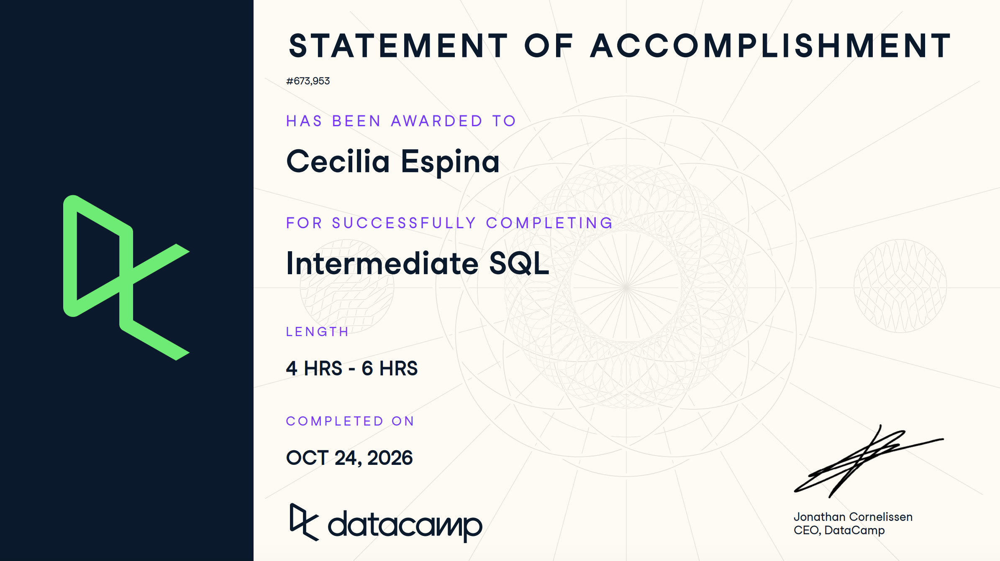

# Course-Completion Evidence



I completed the DataCamp *Intermediate SQL* course on October 24, 2026 through the IBM 6500 DataCamp classroom. All four chapters show 100% progress.

# Learning Notes and Key Takeaways

**About the example tables.** The queries below use placeholder marketing tables so that I can reuse them in my CEP. They are not DataCamp's data.

- `orders`: one row per purchase (`order_id`, `customer_id`, `order_date`, `channel`, `order_total`, `revenue`).
- `web_sessions`: one row per website visit (`session_id`, `channel`, `device_type`, `session_duration_sec`).
- `campaign_performance`: one row per campaign (`campaign_name`, `impressions`, `clicks`, `spend`).
- `customers`: one row per customer (`customer_id`, `email_domain`, `signup_source`, `loyalty_tier`).

None of these contain real customer or confidential data.

## Data Aggregation

**Main ideas:** Aggregation collapses many rows into a few summary numbers. The first lesson (Summary Values) covers calculating totals, averages, and counts across a whole table. The second (One Grouping Column) splits those summaries by category so that I can compare groups. The third (Multiple Grouping Columns) splits by several categories at once, which shows patterns that one category hides. Every column in `SELECT` must either be inside an aggregate function or listed in `GROUP BY`.

**Important SQL syntax:**

- `COUNT(*)`, `COUNT(column)`, `COUNT(DISTINCT column)`
- `SUM()`, `AVG()`, `MIN()`, `MAX()`
- `GROUP BY column_1, column_2`
- `ORDER BY ... DESC`
- `ROUND()` to tidy results
- Column aliases with `AS`

**When to use it:** Use it when the question is "how many," "how much," or "how does this compare across groups," such as revenue by channel, sessions by device, or customers by signup source.

**SQL example 1: summary values for the whole table**

```sql
SELECT
  COUNT(*)                  AS total_orders,
  COUNT(DISTINCT customer_id) AS unique_customers,
  SUM(revenue)              AS total_revenue,
  ROUND(AVG(order_total), 2) AS avg_order_value,
  MIN(order_date)           AS first_order_date,
  MAX(order_date)           AS last_order_date
FROM orders;
```

**SQL example 2: multiple grouping columns**

```sql
SELECT
  channel,
  device_type,
  COUNT(*)                            AS sessions,
  ROUND(AVG(session_duration_sec), 1) AS avg_duration_sec
FROM web_sessions
GROUP BY channel, device_type
ORDER BY sessions DESC;
```

**Explanation:** The first query reads every row in `orders` and returns exactly one row of totals. `COUNT(DISTINCT customer_id)` counts each customer once, even if they ordered several times. The second query puts rows into buckets, one for every channel and device combination (for example, Instagram and mobile), and calculates the count and average duration inside each bucket. It returns one row per combination, sorted from the most sessions to the fewest.

**CEP application:** I can summarize campaign, GA4-style session, or transaction data to get the key numbers for a report. Grouping by channel and device shows which audience segments engage the most, which is a common marketing question.

## Data Transformation

**Main ideas:** Transformation creates new columns by calculating from existing ones. Basic Transformations covers combining and calculating values, such as building a ratio. Complex Transformations covers multi-step calculations where one result depends on another, such as a percentage of a total. The new columns exist only in the query results; the original table is not changed.

**Important SQL syntax:**

- Arithmetic operators `+ - * /`
- Column aliases with `AS`
- `ROUND()`
- Dividing by a total calculated in a subquery: `(SELECT SUM(...) FROM ...)`
- In BigQuery, `SAFE_DIVIDE(a, b)` to avoid divide-by-zero errors

**When to use it:** Use it when the metric I need isn't a column in the data, such as click-through rate, cost per click, or each channel's share of revenue.

**SQL example 1: a ratio from two existing columns**

```sql
SELECT
  campaign_name,
  clicks,
  impressions,
  ROUND(100.0 * clicks / impressions, 2) AS click_through_rate_pct,
  ROUND(spend / clicks, 2)               AS cost_per_click
FROM campaign_performance;
```

**SQL example 2: percentage of a total (multi-step)**

```sql
SELECT
  channel,
  SUM(revenue) AS channel_revenue,
  ROUND(
    100.0 * SUM(revenue) / (SELECT SUM(revenue) FROM orders),
    1
  ) AS pct_of_total_revenue
FROM orders
GROUP BY channel
ORDER BY pct_of_total_revenue DESC;
```

**Explanation:** The first query adds two new columns to each row: clicks divided by impressions (multiplied by 100 to make a percent) and spend divided by clicks. The second query works in two steps. The subquery in parentheses first finds total revenue for the whole table, then each channel's revenue is divided by that total. The result is one row per channel showing its share of overall revenue.

**CEP application:** Marketing metrics like CTR, CPC, conversion rate, and share of revenue are almost always calculated, not stored. I can reuse these patterns to build the metrics in my CEP analysis.

## Data Filtering

**Main ideas:** Filtering keeps only the rows that meet my conditions. Basic Filtering covers `WHERE` with comparisons, missing values, and text patterns. Multiple Conditions covers combining criteria with `AND` and `OR`. Complex Filtering covers moving conditions into their own columns so the logic is easy to check, and using `NOT` to get the opposite of a filter.

**Important SQL syntax:**

- `WHERE` with `=`, `<>`, `>`, `<`, `>=`, `<=`
- `IS NULL` and `IS NOT NULL`
- `LIKE` with `%` as a wildcard
- `AND`, `OR`, and parentheses to control the order
- `NOT`
- A condition written as a column in `SELECT`

**When to use it:** Use it to narrow an analysis to one time period, audience, or campaign, and to find or exclude missing data and text patterns, like email domains.

**SQL example 1: several conditions with a text pattern**

```sql
SELECT customer_id, email_domain, signup_source
FROM customers
WHERE (signup_source = 'instagram' OR signup_source = 'tiktok')
  AND email_domain LIKE '%.edu'
  AND loyalty_tier IS NOT NULL;
```

**SQL example 2: a condition as its own column, and its opposite**

```sql
SELECT
  order_id,
  order_total,
  (order_total >= 100) AS is_large_order
FROM orders;

SELECT order_id, order_total
FROM orders
WHERE NOT (order_total >= 100);
```

**Explanation:** The first query returns customers who signed up from Instagram or TikTok, have an email ending in `.edu`, and have a loyalty tier recorded. The parentheses make `OR` apply first, before `AND`. The second pair shows the "separate column" idea: the first query shows `TRUE` or `FALSE` for every order so I can check my logic, and the second uses `NOT` to return only the orders that are not large.

**CEP application:** I can isolate a survey segment, a date range, or one campaign, remove records with missing values, and double-check that my filter logic is correct before reporting results.

## Conditional Operations

**Main ideas:** Conditional operations apply different rules depending on the data. Conditional Transformation uses `CASE WHEN` to standardize values or sort rows into categories. Conditional Aggregation puts a condition inside an aggregate function so that a summary counts only the rows I care about, within each group.

**Important SQL syntax:**

- `CASE WHEN condition THEN result ... ELSE result END`
- Aggregate functions around `CASE`, such as `COUNT(CASE WHEN ... THEN 1 END)` and `AVG(CASE WHEN ... THEN column END)`
- BigQuery shortcut: `COUNTIF(condition)`

**When to use it:** Use it to bucket values (for example, spend tiers or age groups), clean inconsistent labels, or compare a subset to the whole group in a single query.

**SQL example 1: categorize with CASE WHEN**

```sql
SELECT
  order_id,
  order_total,
  CASE
    WHEN order_total >= 100 THEN 'High value'
    WHEN order_total >= 50  THEN 'Medium value'
    ELSE 'Low value'
  END AS order_segment
FROM orders;
```

**SQL example 2: conditional aggregation by group**

```sql
SELECT
  channel,
  COUNT(*) AS total_sessions,
  COUNT(CASE WHEN device_type = 'mobile' THEN 1 END) AS mobile_sessions,
  ROUND(AVG(CASE WHEN device_type = 'mobile'
                 THEN session_duration_sec END), 1) AS avg_mobile_duration_sec
FROM web_sessions
GROUP BY channel;
```

**Explanation:** The first query checks each order against the `WHEN` rules from top to bottom and stops at the first one that is true, assigning a label in the new `order_segment` column. The `ELSE` catches everything else. The second query groups by channel, then counts all sessions and, separately, counts only mobile sessions. Rows that fail the `CASE` condition become `NULL`, and aggregate functions ignore `NULL`, so the average covers mobile sessions only.

**CEP application:** I can build segments like high/medium/low spenders or engaged/unengaged visitors, and compare a segment to the total in the same table, such as mobile engagement versus overall engagement for each channel.

# Overall Reflection and Series Synthesis

**Most useful concepts.** The most useful pattern was combining `GROUP BY` with calculated metrics, because most marketing questions are "how does this metric compare across groups." `CASE WHEN` was also very useful because it lets me create my own categories without changing the source data.

**Most challenging concepts.** The most challenging concepts were conditional aggregation and combining `AND` with `OR` in a `WHERE` clause. With conditional aggregation, it was hard to see why putting `CASE WHEN` inside `AVG()` or `COUNT()` only counts the matching rows. It made sense once I understood that rows that don't meet the condition become `NULL`, and aggregate functions ignore `NULL`. For `AND`/`OR`, I resolved my confusion by adding parentheses to make the order explicit and by testing the condition as its own column first, as in the Data Filtering chapter, so I could see which rows were `TRUE` or `FALSE` before filtering on it. Re-running exercises and reading the error messages also helped when my query didn't work.

**How this extended Introduction to SQL.** Introduction to SQL taught me how to select, filter, sort, and summarize in simple ways. This course added multi-column grouping, calculated metrics, more careful filtering logic, and conditional logic, so that I can answer more realistic business questions in one query.

**Applying these skills in BigQuery.** BigQuery uses standard SQL, so these patterns carry over directly. I can also use BigQuery shortcuts like `COUNTIF()` and `SAFE_DIVIDE()` for conditional counts and safe ratios.

**Digital marketing, survey, GA4, and CEP uses.** I can summarize campaign performance, segment customers or survey respondents, calculate rates and shares of totals, and filter to specific audiences or time periods. These are the building blocks for the analysis in my CEP.

**Sections I will consult again.** I expect to come back to the Data Transformation section for ratios and percent-of-total calculations, and to the Conditional Operations section for `CASE WHEN` and conditional aggregation, since I'll likely need both to build segments and metrics for my CEP. I'll also keep my Introduction to BigQuery report handy for how to run these queries in BigQuery, and my Introduction to SQL report for the basics of selecting, filtering, and sorting.

# Appendix: Publication Links

- [GitHub Repository](https://github.com/espinacecilia-design/6500)
- [Published Intermediate SQL Report](https://espinacecilia-design.github.io/6500/intermediate-sql.html)
- [Published Portfolio Landing Page](https://espinacecilia-design.github.io/6500/index.html)