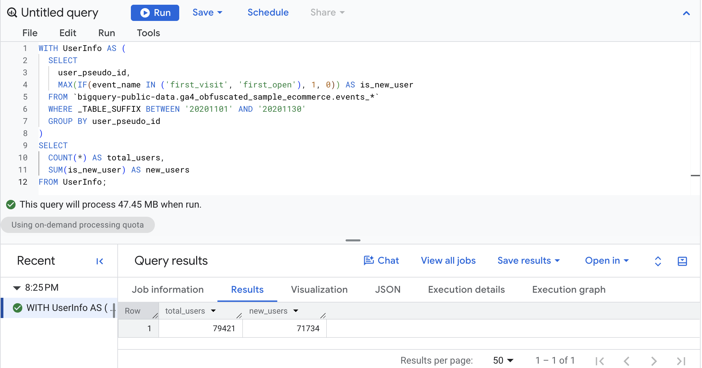
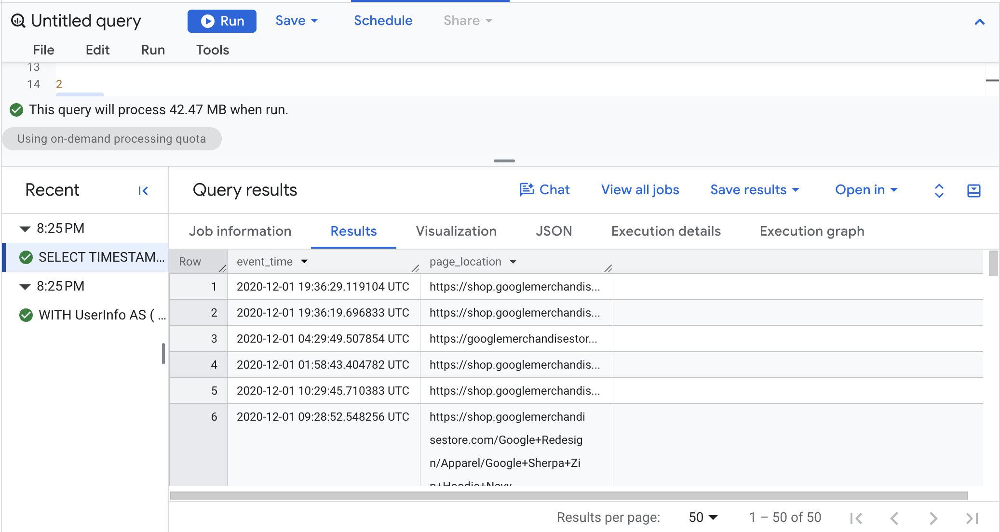
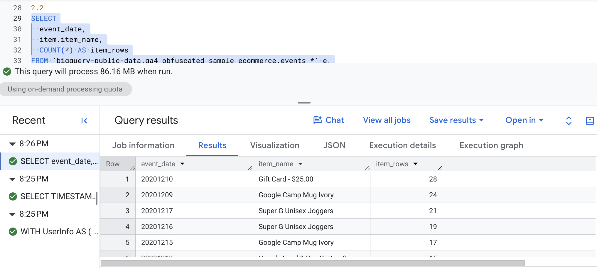
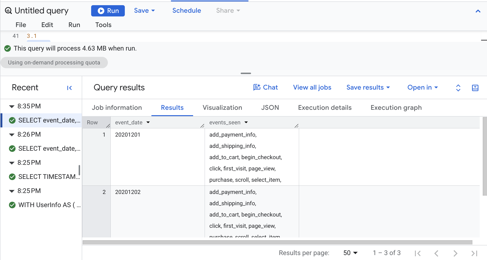
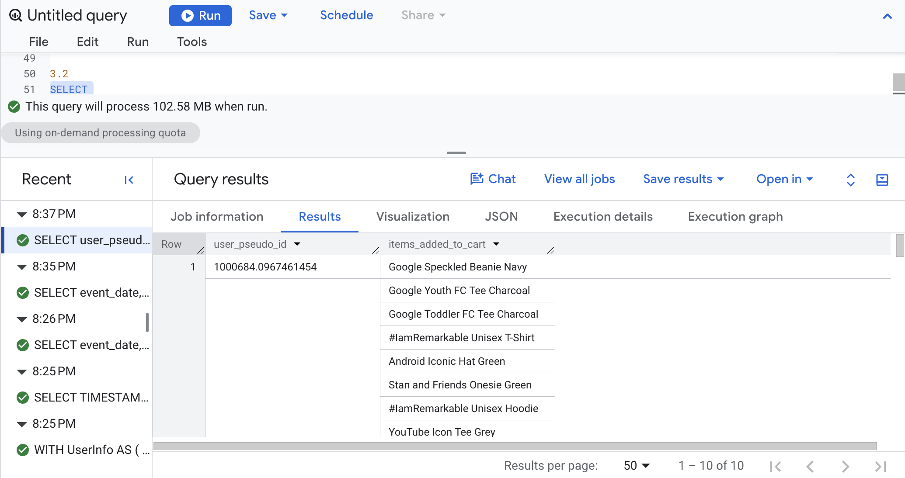
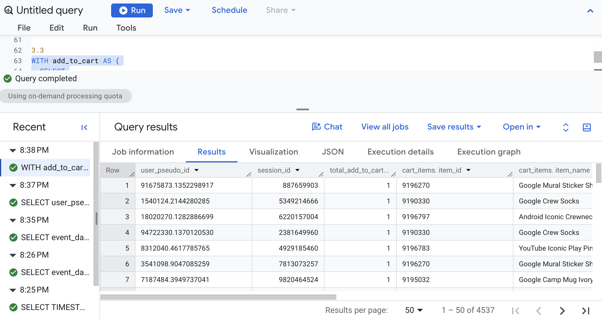
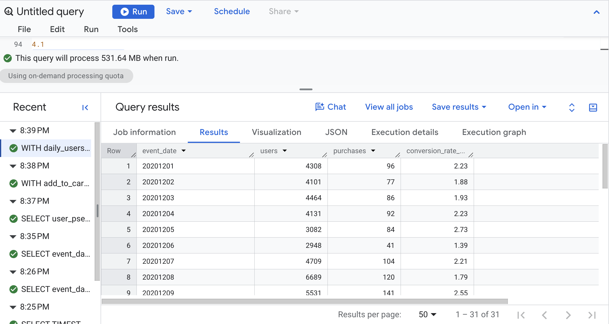
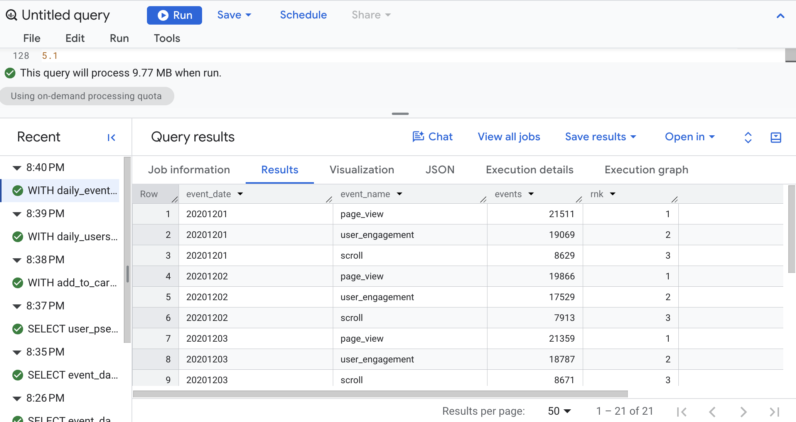
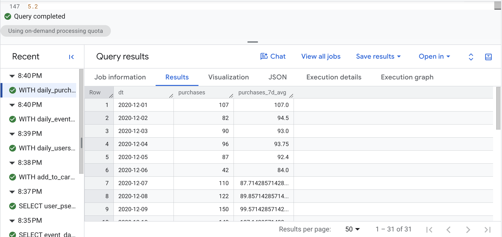
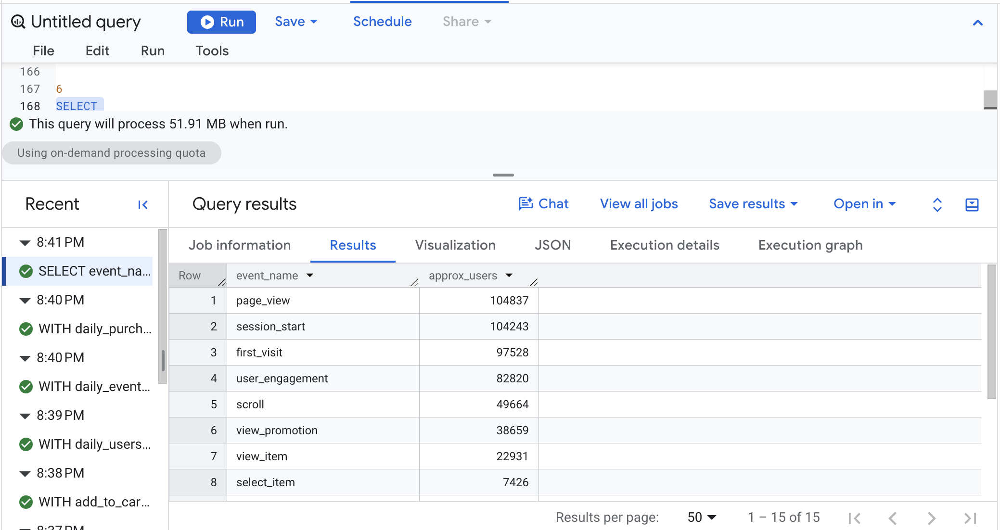

# Introduction

This report documents the queries from Lecture 2, run in Google BigQuery against the public GA4 sample e-commerce dataset (`bigquery-public-data.ga4_obfuscated_sample_ecommerce.events_*`). The queries cover CTEs, arrays and `UNNEST`, `STRING_AGG` / `ARRAY_AGG`, joins, window functions with `QUALIFY`, and approximate aggregate functions. Each section shows the query, explains what it does, and includes a screenshot of the output.

# 1. CTEs (WITH)

A CTE (common table expression) creates a named "mini table" inside a query so the logic can be built in readable steps.

## Query 1.1: Total Users and New Users

### The Query

``` sql
-- Query 1.1: Total users and new users (November 2020)
WITH UserInfo AS (
  SELECT
    user_pseudo_id,
    -- 1 if the user ever triggered a first_visit / first_open event, else 0
    MAX(IF(event_name IN ('first_visit', 'first_open'), 1, 0)) AS is_new_user
  FROM `bigquery-public-data.ga4_obfuscated_sample_ecommerce.events_*`
  WHERE _TABLE_SUFFIX BETWEEN '20201101' AND '20201130'
  GROUP BY user_pseudo_id
)
SELECT
  COUNT(*) AS total_users,
  SUM(is_new_user) AS new_users
FROM UserInfo;
```

### What the Query Does

The CTE `UserInfo` builds one row per user (`user_pseudo_id`) for November 2020. `MAX(IF(...))` flags a user as new (1) if any of their events was `first_visit` or `first_open`, and 0 otherwise. The final `SELECT` counts the rows to get total users and sums the flag to get new users. `_TABLE_SUFFIX` limits the wildcard table to the November date range, which controls cost.

### Output



### Interpretation

The query returned 79,421 total users and 71,734 new users in November 2020. That means about 90% of users were visiting for the first time, which suggests the store was mostly reaching new visitors rather than repeat customers during this period.

# 2. Arrays and UNNEST

GA4 stores many fields inside arrays, such as `event_params` (key/value pairs) and `items` (products in commerce events).

## Query 2.1: Pattern A, Scalar Subquery Extraction

### The Query

``` sql
-- Query 2.1 (Pattern A): Scalar subquery extraction of page_location
SELECT
  TIMESTAMP_MICROS(event_timestamp) AS event_time,
  (
    SELECT value.string_value
    FROM UNNEST(event_params)
    WHERE key = 'page_location'
    LIMIT 1
  ) AS page_location
FROM `bigquery-public-data.ga4_obfuscated_sample_ecommerce.events_*`
WHERE event_name = 'page_view'
  AND _TABLE_SUFFIX BETWEEN '20201201' AND '20201202'
LIMIT 50;
```

### What the Query Does

For each `page_view` event on Dec 1 to 2, 2020, the query converts the microsecond timestamp into a readable `TIMESTAMP`. A subquery then looks inside the `event_params` array and pulls out the string value whose key is `page_location` (the page URL). Because the subquery returns one value per row, the number of rows does not change. `LIMIT 50` keeps the output small.

### Output



### Interpretation

All the URLs belong to the Google Merchandise Store. Visitors land on the home page and browse category pages (such as Apparel, Drinkware and Shop by Brand) and individual product pages. The list also includes checkout-flow pages (basket, payment, review order, order completed), which shows the full path from browsing to buying appears in page_view data.

## Query 2.2: Pattern B, Flattening Items with UNNEST

### The Query

``` sql
-- Query 2.2 (Pattern B): Flattening items with UNNEST in FROM
SELECT
  event_date,
  item.item_name,
  COUNT(*) AS item_rows
FROM `bigquery-public-data.ga4_obfuscated_sample_ecommerce.events_*` e,
UNNEST(e.items) AS item
WHERE e.event_name = 'purchase'
  AND _TABLE_SUFFIX BETWEEN '20201201' AND '20201231'
GROUP BY event_date, item.item_name
ORDER BY item_rows DESC
LIMIT 20;
```

### What the Query Does

`UNNEST(e.items)` explodes the `items` array so each purchased product gets its own row. This changes the grain of the data: one purchase event with three products becomes three rows (item-row per event), not one. The query then counts how many purchase item rows each product has per day in December 2020, sorts from highest to lowest, and shows the top 20.

### Output



### Interpretation

The top row is "Gift Card - \$25.00" on Dec 10, 2020, with 28 purchase item rows, followed by "Google Camp Mug Ivory" on Dec 9 (24) and "Super G Unisex Joggers" on Dec 17 (21) and Dec 16 (19). Many of the top days fall in mid-December, which fits holiday shopping. One row has the item name "(not set)" (Dec 30, 15 rows), which points to missing item data in GA4.

# 3. STRING_AGG and ARRAY_AGG

These functions combine many values into one row per group.

## Query 3.1: Event Names Seen per Day

### The Query

``` sql
-- Query 3.1: Event names seen per day
SELECT
  event_date,
  STRING_AGG(DISTINCT event_name, ', ' ORDER BY event_name) AS events_seen
FROM `bigquery-public-data.ga4_obfuscated_sample_ecommerce.events_*`
WHERE _TABLE_SUFFIX BETWEEN '20201201' AND '20201203'
GROUP BY event_date
ORDER BY event_date;
```

### What the Query Does

For Dec 1 to 3, 2020, the query groups rows by `event_date` and uses `STRING_AGG` to join the distinct event names for that day into a single comma-separated, alphabetized text string. The result is one row per day listing every event type that occurred.

### Output



### Interpretation

Each day lists 16 to 17 different event types, covering the whole shopping funnel: page_view, view_item, add_to_cart, begin_checkout, add_payment_info and purchase. Dec 1 includes `view_item_list`, which does not appear on Dec 2 or Dec 3. Otherwise the event types are the same each day.

## Query 3.2: Items Added to Cart per User (Use Case 1)

### The Query

``` sql
-- Query 3.2 (Use Case 1): List of items added to cart per user
SELECT
  user_pseudo_id,
  ARRAY_AGG(item.item_name) AS items_added_to_cart
FROM `bigquery-public-data.ga4_obfuscated_sample_ecommerce.events_*`,
UNNEST(items) AS item
WHERE event_name = 'add_to_cart'
  AND _TABLE_SUFFIX BETWEEN '20201201' AND '20201231'
GROUP BY user_pseudo_id
ORDER BY user_pseudo_id
LIMIT 10;
```

### What the Query Does

The query unnests `items` for every `add_to_cart` event in December 2020, then groups by user. `ARRAY_AGG` collects each user's item names into an array, so each user appears on one row with a list of everything they added to their cart. Results are sorted by user ID and limited to 10 users. (I wrote `item.item_name` to make clear the field comes from the unnested `item`.)

### Output

Interpretation

Each user appears on one row with an array of every item they added to their cart. The lists vary a lot in length: one user added only two campus stickers, while others have dozens of entries. Items repeat inside a list (for example, "Google Land & Sea Journal Set" appears several times) because every add_to_cart event is its own array element. Users also tend to add similar products (all stickers, all hats, or all apparel).

## Query 3.3: Session-Level Cart Summary (Use Case 2)

### The Query

``` sql
-- Query 3.3 (Use Case 2): Session-level cart summary using ARRAY_AGG
WITH add_to_cart AS (
  SELECT
    user_pseudo_id,
    (
      SELECT value.int_value
      FROM UNNEST(event_params)
      WHERE key = 'ga_session_id'
    ) AS session_id,
    TIMESTAMP_MICROS(event_timestamp) AS event_timestamp,
    i.item_id,
    i.item_name,
    i.quantity,
    i.price
  FROM `bigquery-public-data.ga4_obfuscated_sample_ecommerce.events_*`,
  UNNEST(items) AS i
  WHERE event_name = 'add_to_cart'
    AND _TABLE_SUFFIX BETWEEN '20210101' AND '20211231'  -- cost control
)
SELECT
  user_pseudo_id,
  session_id,
  COUNT(*) AS total_add_to_cart_events,
  ARRAY_AGG(
    STRUCT(item_id, item_name, quantity, price, event_timestamp)
    ORDER BY quantity DESC, event_timestamp ASC
    LIMIT 10
  ) AS cart_items
FROM add_to_cart
WHERE session_id IS NOT NULL  -- filter out rows with no session id
GROUP BY user_pseudo_id, session_id;
```

### What the Query Does

The CTE `add_to_cart` extracts the session ID (`ga_session_id`) from `event_params`, unnests the items, and keeps item details for each `add_to_cart` event. The main query groups by user and session, counts the add-to-cart events, and uses `ARRAY_AGG(STRUCT(...))` to bundle each item's details into a nested "cart" array, sorted by quantity (highest first) and then time, keeping up to 10 items. Rows with no session ID are filtered out. The date range is 2021, and the sample dataset ends on Jan 31, 2021, so only January 2021 data is returned.

### Output



### Interpretation

Each row is one session, with a count of add-to-cart item rows and a nested `cart_items` array. In the sessions I checked, the count ranged from 1 (a single Google Campus Bike) to 204 add-to-cart item rows in one session. Many items have a `NULL` quantity, so quantity is not always recorded in the data. Because the date range covers 2021 and the dataset ends on Jan 31, 2021, these sessions are all from the last days of the dataset.

# 4. Joins

A join combines results from two tables (or CTEs) using a matching key.

## Query 4.1: Daily Users, Purchases, and Conversion Rate

### The Query

``` sql
-- Query 4.1: Daily users joined with daily purchases and conversion rate
WITH daily_users AS (
  SELECT
    event_date,
    COUNT(DISTINCT user_pseudo_id) AS users
  FROM `bigquery-public-data.ga4_obfuscated_sample_ecommerce.events_*`
  WHERE _TABLE_SUFFIX BETWEEN '20201201' AND '20201231'
  GROUP BY event_date
),
daily_purchases AS (
  SELECT
    event_date,
    COUNT(DISTINCT
      (SELECT value.string_value
       FROM UNNEST(event_params)
       WHERE key = 'transaction_id')
    ) AS purchases  -- distinct transactions
  FROM `bigquery-public-data.ga4_obfuscated_sample_ecommerce.events_*`
  WHERE event_name = 'purchase'
    AND _TABLE_SUFFIX BETWEEN '20201201' AND '20201231'
  GROUP BY event_date
)
SELECT
  u.event_date,
  u.users,
  -- Turns "no purchase row (NULL)" into 0 purchases
  IFNULL(p.purchases, 0) AS purchases,
  -- Conversion rate: % of daily users who made a purchase
  ROUND(
    IFNULL(p.purchases, 0) / NULLIF(u.users, 0) * 100, 2
  ) AS conversion_rate_pct  -- NULLIF prevents division by zero
FROM daily_users u
LEFT JOIN daily_purchases p
  ON u.event_date = p.event_date
ORDER BY u.event_date;
```

### What the Query Does

Two CTEs are built for December 2020. `daily_users` counts distinct users per day. `daily_purchases` counts distinct transaction IDs (pulled from `event_params`) from `purchase` events per day. A `LEFT JOIN` keeps every day from `daily_users`, even days with no purchases. `IFNULL` turns missing purchase counts into 0, and the conversion rate is purchases divided by users times 100, rounded to 2 decimals. `NULLIF` avoids dividing by zero.

### Output



### Interpretation

Daily users range from 2,444 (Dec 31) to 6,689 (Dec 8). The conversion rate is typically about 2% to 3% in the first three weeks of December, peaking at 3.13% on Dec 11 (155 purchases from 4,948 users). It drops sharply from Dec 19 onward, to about 0.6% to 1% around Dec 20 and Dec 24 to 27, with the lowest on Dec 26 (0.61%). Late-December shoppers likely stopped buying because shipping deadlines passed before the holidays.

# 5. Window Functions and QUALIFY

Window functions calculate values across related rows without collapsing them into one row per group. `QUALIFY` filters the results of window functions.

## Query 5.1: Top 3 Event Types per Day

### The Query

``` sql
-- Query 5.1: Top 3 event types per day (RANK + QUALIFY)
WITH daily_event_counts AS (
  SELECT
    event_date,
    event_name,
    COUNT(*) AS events
  FROM `bigquery-public-data.ga4_obfuscated_sample_ecommerce.events_*`
  WHERE _TABLE_SUFFIX BETWEEN '20201201' AND '20201207'
  GROUP BY event_date, event_name
)
SELECT
  event_date,
  event_name,
  events,
  RANK() OVER (PARTITION BY event_date ORDER BY events DESC) AS rnk
FROM daily_event_counts
QUALIFY rnk <= 3
ORDER BY event_date, rnk;
```

### What the Query Does

The CTE counts how many times each event type happened on each day, Dec 1 to 7, 2020. `RANK() OVER (PARTITION BY event_date ORDER BY events DESC)` ranks event types within each day from most to least frequent. `QUALIFY rnk <= 3` keeps only the top 3 per day, without needing a subquery.

### Output



### Interpretation

The top 3 events are the same every day, in the same order: `page_view` (1st), `user_engagement` (2nd) and `scroll` (3rd). Their counts change with traffic: page_view peaks at 21,511 on Dec 1 and drops to 13,065 on Dec 6 (a Sunday). Purchase events never make the top 3 because they are far rarer than browsing events.

## Query 5.2: Rolling 7-Day Average of Daily Purchases

### The Query

``` sql
-- Query 5.2: Rolling 7-day average of daily purchases
WITH daily_purchases AS (
  SELECT
    PARSE_DATE('%Y%m%d', event_date) AS dt,
    COUNT(*) AS purchases
  FROM `bigquery-public-data.ga4_obfuscated_sample_ecommerce.events_*`
  WHERE event_name = 'purchase'
    AND _TABLE_SUFFIX BETWEEN '20201201' AND '20201231'
  GROUP BY dt
)
SELECT
  dt,
  purchases,
  AVG(purchases) OVER (
    ORDER BY dt
    ROWS BETWEEN 6 PRECEDING AND CURRENT ROW
  ) AS purchases_7d_avg
FROM daily_purchases
ORDER BY dt;
```

### What the Query Does

The CTE counts `purchase` events per day for December 2020 and converts the text date (`YYYYMMDD`) into a real `DATE` using `PARSE_DATE`. The main query uses `AVG(...) OVER (ORDER BY dt ROWS BETWEEN 6 PRECEDING AND CURRENT ROW)` to average each day with the 6 days before it, creating a 7-day moving average that smooths daily ups and downs. The first six days average over fewer than 7 days because there is not enough earlier data.

### Output



### Interpretation

Daily purchases bounce around a lot (for example, 160 on Dec 11 but 74 on Dec 13), but the 7-day average smooths that out. The average rises from about 94 at the start of December to a peak of about 124 around Dec 15, then declines steadily to about 25 by Dec 31. The rolling average shows the holiday-shopping rise and fall more clearly than the raw daily counts.

# 6. Approximate Functions

Approximate functions return "close enough" answers faster on very large datasets.

## Query 6.1: Approximate Distinct Users per Event Type

### The Query

``` sql
-- Query 6.1: Approximate distinct users per event type
SELECT
  event_name,
  APPROX_COUNT_DISTINCT(user_pseudo_id) AS approx_users
FROM `bigquery-public-data.ga4_obfuscated_sample_ecommerce.events_*`
WHERE _TABLE_SUFFIX BETWEEN '20201201' AND '20201231'
GROUP BY event_name
ORDER BY approx_users DESC
LIMIT 15;
```

### What the Query Does

For December 2020, the query groups events by `event_name` and uses `APPROX_COUNT_DISTINCT` to estimate how many different users triggered each event. It is faster and cheaper than `COUNT(DISTINCT ...)` on big data, with a small margin of error. Results are sorted from most to fewest users and limited to the top 15 event types.

### Output



### Interpretation

`page_view` reaches the most users (about 104,837), followed by `session_start`, `first_visit` and `user_engagement`. The numbers drop at each step of the funnel: about 22,931 users viewed an item, 7,109 added to cart, 3,855 began checkout and about 1,973 purchased. Most of the drop-off happens between viewing an item and adding it to the cart.

# Conclusion

Running these queries showed me how much of GA4's value sits inside nested data. CTEs let me break a question into readable steps, and `UNNEST` unlocked the `event_params` and `items` arrays, though I learned it changes the grain of the data, so I have to be careful about what each row represents. `STRING_AGG` and `ARRAY_AGG` summarized many values into one row, joins combined daily users with purchases to calculate conversion rate, and window functions with `QUALIFY` handled rankings and a 7-day rolling average without collapsing rows.

The results also told a clear business story for the Google Merchandise Store. Most users in November were new, page views, engagement and scrolling dominated daily activity, and the funnel narrowed at each step from viewing an item (about 22,900 users) to purchasing (about 2,000 users). December conversion peaked in mid-month and fell sharply in the last week, which likely reflects holiday shipping deadlines. As a digital marketing student, I can use these techniques to answer audience and campaign questions directly from raw GA4 data.

# Appendix

- GitHub Pages: [https://espinacecilia-design.github.io/6500/lecture2-ga4/lecture2-ga4.html](https://espinacecilia-design.github.io/6500/lecture2-ga4/lecture2-ga4.html)
- GitHub repo: [https://github.com/espinacecilia-design/6500](https://github.com/espinacecilia-design/6500)
- SQL file: `lecture2-ga4.sql`